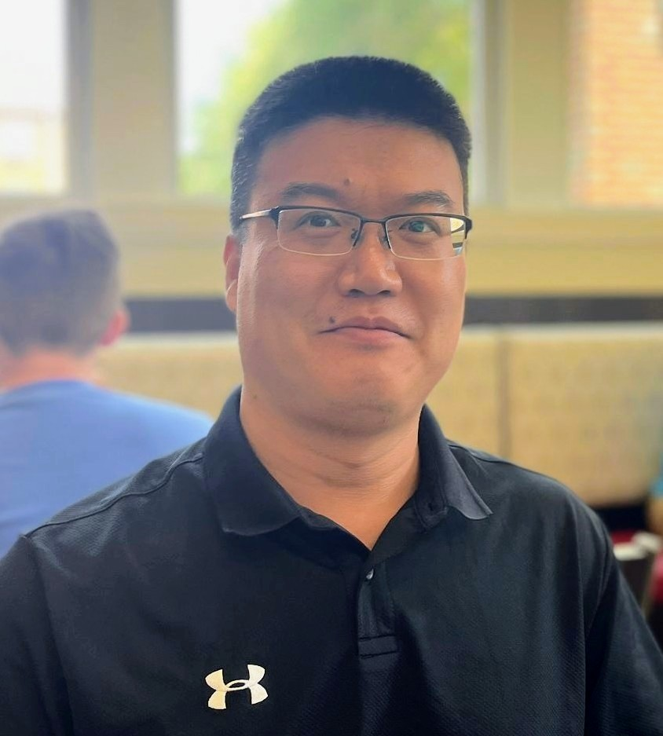

[Assistant Professor in Economics @ Delta State University]{.subtitle-line}

::: {.hero}
{.headshot fig-alt="Photo of Liandong (Landon) Yang"}

::: {.hero-text}
Hello, I am Landon.

I am an Assistant Professor in Economics at [Delta State University](https://www.deltastate.edu). My research focuses on sovereign debt, China's Economy, monetary policy and exchange rate regime. [One more sentence about what you are working on or looking for.]

**Email:** lyang@deltastate.edu · [CV](cv.qmd) ([PDF](assets/files/CV.pdf))

::: {.social}
[<i class="bi bi-linkedin"></i>](https://www.linkedin.com/in/your-profile "LinkedIn")
[<i class="bi bi-mortarboard"></i>](https://scholar.google.com/citations?user=YOURID "Google Scholar")
[<i class="bi bi-github"></i>](https://github.com/landon-liandong-yang "GitHub")
:::
:::
:::

::: {.card-section}
### Research

**Sustaining the Unsustainable? Greek Government Debt Before and After the Euro**

*Job market paper* · [Paper](research.qmd)

[All papers and work in progress →](research.qmd)
:::

::: {.card-section}
### Teaching

**Course or role, university**

One sentence about what you teach or assist with.

[Teaching details →](teaching.qmd)
:::
